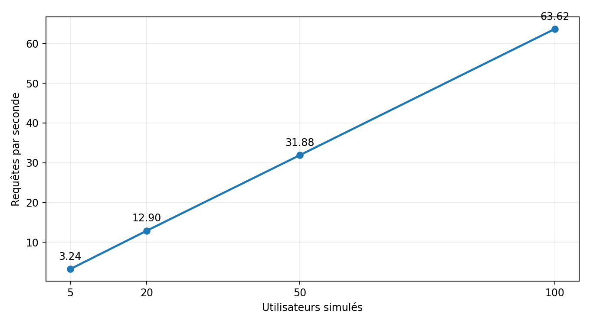
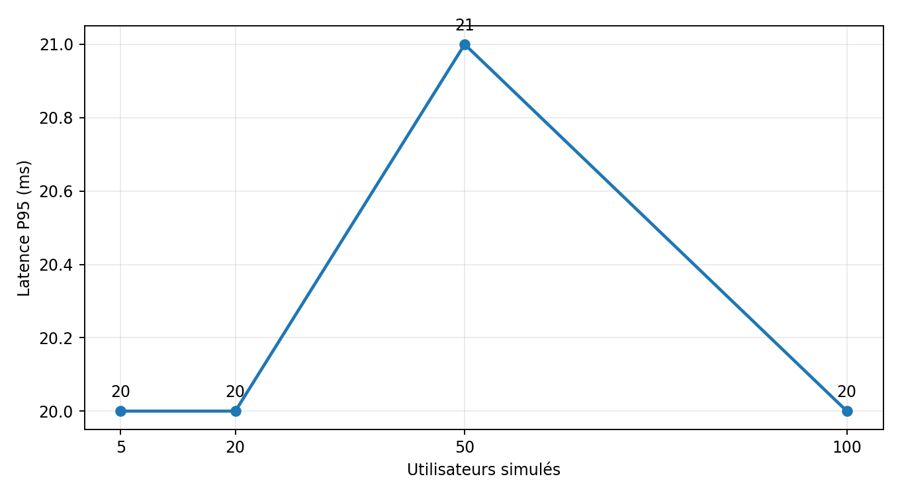

# Rapport de performance — CreditRisk-Test

**Date :** 9 novembre 2026  
**Version :** 1.0  
**Nature :** Essais locaux de charge HTTP avec Locust  
**Statut :** Qualification technique limitée aux scénarios testés

## 1. Objectif et périmètre

Évaluer la stabilité de l’API FastAPI de prédiction du risque de crédit sous quatre niveaux de charge simulée, en mesurant le débit, les latences et les échecs applicatifs. Les essais concernent `POST /predict` sur un serveur Uvicorn local (`127.0.0.1:8000`).

## 2. Méthode

Locust simule 5, 20, 50 puis 100 utilisateurs, avec un temps d’attente aléatoire de 1 à 2 secondes entre les requêtes de chaque utilisateur. Les scénarios de 5, 20 et 50 utilisateurs ont été programmés pour 60 secondes chacun, celui de 100 utilisateurs pour 120 secondes. Les rampes de montée en charge sont respectivement de 1, 5, 10 et 10 utilisateurs/seconde. Chaque requête transmet le même dossier synthétique et vérifie une réponse HTTP 200 ainsi qu’une probabilité comprise entre 0 et 1.

Les résultats ci-dessous proviennent des lignes `Aggregated` des fichiers `load_*_stats.csv`. Les fichiers d’échecs et d’exceptions associés ne contiennent pas d’événement enregistré.

## 3. Résultats observés

| Utilisateurs | Requêtes | Échecs | Débit (req/s) | Moyenne (ms) | P95 (ms) | P99 (ms) | Maximum (ms) |
|---:|---:|---:|---:|---:|---:|---:|---:|
| 5 | 191 | 0 | 3.24 | 31.04 | 20 | 810 | 1818.21 |
| 20 | 767 | 0 | 12.90 | 17.17 | 20 | 24 | 32.23 |
| 50 | 1 895 | 0 | 31.88 | 16.95 | 21 | 31 | 37.93 |
| 100 | 7 565 | 0 | 63.62 | 16.28 | 20 | 30 | 169.30 |

**Total :** 10 418 requêtes, 0 échec observé. Le débit total ne se calcule pas en additionnant les débits de scénarios distincts.

## 4. Analyse

**Évolution du débit.** Le débit mesuré augmente presque proportionnellement au nombre d’utilisateurs (3,24 à 63,62 req/s). Avec une attente de 1 à 2 secondes entre tâches, ce résultat n’indique pas le débit maximal du serveur.

**Stabilité de la latence.** La latence P95 reste comprise entre 20 et 21 ms dans les quatre scénarios. Les résultats ne montrent pas de dégradation nette du P95 jusqu’à 100 utilisateurs simulés.

**Valeurs atypiques.** À 5 utilisateurs, une latence maximale de 1 818,21 ms et un P99 de 810 ms sont observés, alors que le P95 est de 20 ms. Ce phénomène doit être investigué (démarrage, chargement ponctuel, contention ou bruit local) ; sa cause n’est pas établie. À 100 utilisateurs, le maximum est de 169,30 ms.

**Fiabilité pendant les essais.** Aucun échec ni exception n’est consigné dans les exports Locust. Ce résultat ne garantit pas l’absence d’échec sur des charges plus fortes ou sur une période prolongée.

## 5. Critères d’acceptation proposés

| Critère pédagogique | Seuil proposé | Résultat | Appréciation |
|---|---|---|---|
| Taux d’échec des requêtes | 0 % | 0 % dans les quatre scénarios | Satisfait |
| Latence P95 | < 100 ms | 20 à 21 ms | Satisfait |
| Débit à 100 utilisateurs | À caractériser, sans seuil préétabli | 63,62 req/s | Mesuré, non qualifiable sans cible |
| Tenue en charge prolongée | Essai d’endurance requis | Non réalisé | Non évalué |

Ces seuils sont des propositions pédagogiques, non des exigences contractuelles de l’énoncé ni des objectifs de production validés.

## 6. Limites et risques

- Tests effectués sur une seule machine locale : le réseau externe, les proxys et l’infrastructure de production ne sont pas représentés.
- Une seule configuration de serveur, un seul jeu d’entrée et une charge générée depuis l’environnement local.
- Les temps d’attente Locust limitent le rythme des requêtes ; 100 utilisateurs simulés ne signifient pas 100 requêtes simultanément en permanence.
- Absence de mesures de CPU, mémoire, saturation, endurance et reprise après incident.
- Les performances logicielles ne prouvent pas la pertinence du modèle IA : la baseline actuelle affiche un rappel de 14,65 % sur données synthétiques.

## 7. Conclusion et recommandations

**Avis : satisfaisant pour les scénarios locaux réalisés ; non qualifié pour la production.** L’API a traité 10 418 requêtes sans échec enregistré et maintenu un P95 proche de 20 ms. Avant une qualification opérationnelle, compléter par des essais à débit contrôlé, des charges plus élevées, un test d’endurance, des métriques système, des données variées et des essais sur infrastructure représentative. Investiguer le pic de latence à 5 utilisateurs.

## 8. Traçabilité des preuves

Sources : `load_5_stats.csv`, `load_20_stats.csv`, `load_50_stats.csv`, `load_100_stats.csv`, ainsi que leurs fichiers `*_stats_history.csv`, `*_failures.csv` et `*_exceptions.csv`. Les graphiques ont été produits à partir des statistiques agrégées.
